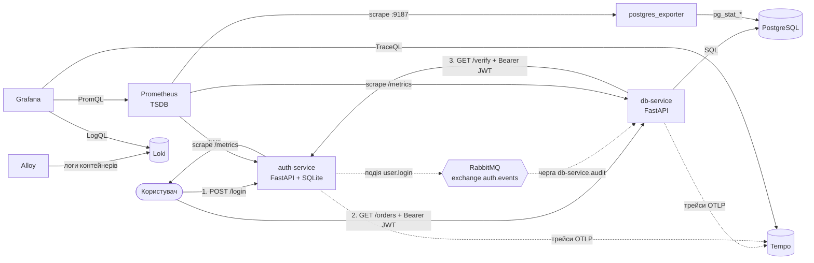
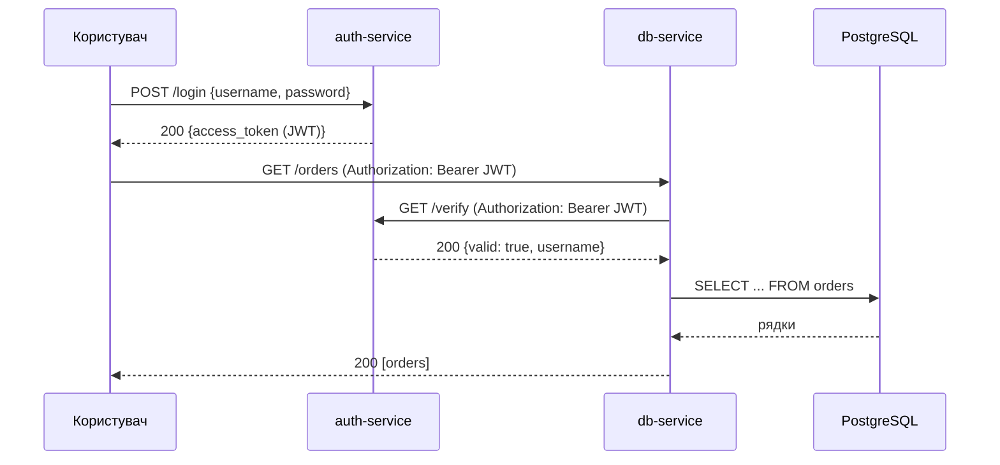
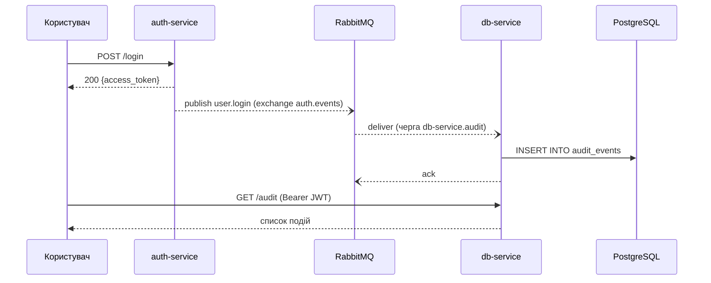

# Архітектура (скелет системи)

Система складається з **двох мікросервісів** та інфраструктури моніторингу.

| Компонент | Роль | Порт |
|---|---|---|
| **db-service** (мікросервіс 1) | Робота з PostgreSQL: фонове навантаження + REST API `/orders`; віддає метрики на `/metrics` | 8000 |
| **auth-service** (мікросервіс 2) | Реєстрація, логін, видача й перевірка JWT. Користувачі в SQLite | 8001 |
| RabbitMQ | Брокер повідомлень: події від auth-service до db-service. Веб-інтерфейс керування | 5672 (AMQP), 15672 (UI) |
| PostgreSQL | СУБД у Docker | 5433 (з хоста) |
| postgres_exporter | Перетворює внутрішню статистику PostgreSQL на метрики Prometheus | 9187 (всередині мережі) |
| Prometheus | Збирає метрики кожні 5 с, зберігає у власній TSDB | 9090 |
| Loki | Сховище логів | 3100 |
| Alloy | Збирає логи всіх контейнерів проєкту через Docker API і відправляє в Loki | 12345 (всередині мережі) |
| Tempo | Сховище трейсів, приймає їх від сервісів по OTLP | 3200 (API), 4318 (OTLP HTTP) |
| Grafana | Дашборд «PostgreSQL Overview» (метрики з Prometheus, логи з Loki, трейси з Tempo) | 3000 |

## Схема



## Взаємодія між мікросервісами

Сервіси спілкуються двома способами:

1. **Синхронно по HTTP (REST)**: перевірка токена (`GET /verify`).
2. **Асинхронно через брокер RabbitMQ**: події про користувачів.

Контракт REST описаний у OpenAPI, який FastAPI генерує автоматично:

- http://localhost:8001/docs — API auth-service
- http://localhost:8000/docs — API db-service

Послідовність запиту до захищеного ендпоінта:



Якщо токена немає або він недійсний, `auth-service` відповідає 401, а
`db-service` повертає 401 клієнту. Якщо `auth-service` недоступний —
`db-service` повертає 503.

## Асинхронна взаємодія через RabbitMQ

auth-service **публікує** події, db-service їх **споживає** і зберігає в
таблицю `audit_events` у PostgreSQL. Сервіси не знають один про одного:
між ними лише контракт повідомлень.



| Параметр | Значення |
|---|---|
| Exchange | `auth.events`, тип `topic`, durable |
| Черга | `db-service.audit`, durable, binding `user.*` |
| Routing keys | `user.registered`, `user.login`, `user.login_failed` |
| Формат | JSON: `{event_id (UUID), type, username, timestamp (ISO 8601)}` |

Гарантії та надійність:

- повідомлення персистентні (`delivery_mode=2`), черга durable;
- `ack` лише після запису в БД; при помилці БД повідомлення повертається в чергу;
- дублікати ігноруються за унікальним `event_id`;
- некоректні повідомлення відкидаються й рахуються в метриці `app_events_failed_total{reason="bad_message"}`;
- якщо брокер недоступний, auth-service **продовжує працювати** (логін не залежить від брокера), помилка рахується в `auth_events_published_total{result="error"}`; споживач db-service перепідключається кожні 5 с.

## Контракт API

### auth-service

| Метод і шлях | Опис | Відповіді |
|---|---|---|
| `POST /register` | `{username, password}` → створює користувача | 201, 409 (існує), 422 |
| `POST /login` | `{username, password}` → `{access_token, token_type, expires_in}` | 200, 401 |
| `GET /verify` | Перевіряє Bearer-токен → `{valid, username}` | 200, 401 |
| `GET /health` | Стан сервісу | 200 |
| `GET /metrics` | Метрики Prometheus | 200 |

### db-service

| Метод і шлях | Опис | Відповіді |
|---|---|---|
| `GET /orders?limit=10` | Останні замовлення (потрібен токен) | 200, 401, 503 |
| `GET /audit?limit=20` | Події auth-service, отримані через RabbitMQ (потрібен токен) | 200, 401, 503 |
| `POST /orders` | `{customer, amount}` → нове замовлення (потрібен токен) | 201, 401, 422, 503 |
| `GET /health` | Стан сервісу | 200 |
| `GET /metrics` | Метрики Prometheus | 200 |

## Метрики

Prometheus збирає два види метрик про роботу з БД:

1. **Метрики СУБД** (postgres_exporter): `pg_stat_database_*` — транзакції,
   з'єднання, зміни рядків, cache hit, розмір БД.
2. **Метрики застосунку** (db-service): `app_db_operations_total`,
   `app_db_errors_total`, `app_db_operation_seconds` — кількість і затримка
   операцій за типами (insert, update, delete, select, aggregate, api_*).

Метрики auth-service: `auth_login_total{result}`, `auth_verify_total{result}`,
`auth_register_total`, `auth_events_published_total{event,result}`.

Метрики брокерної взаємодії в db-service: `app_events_consumed_total{event}`,
`app_events_failed_total{reason}`.

## Логи (Loki)

Alloy через Docker API знаходить усі контейнери docker compose, читає їх
stdout/stderr і відправляє в Loki з мітками `service` (назва сервісу
compose) та `container`. Нічого в самих сервісах для цього налаштовувати не
треба: достатньо писати логи в консоль.

Приклади запитів LogQL (Grafana → Explore → джерело Loki):

| Запит | Що показує |
|---|---|
| `{service="auth-service"}` | усі логи auth-service |
| `{service="auth-service"} \|= "Невдала спроба"` | невдалі входи |
| `{service="db-service"} \|= "Споживач"` | робота споживача RabbitMQ |
| `{service=~".+"} \|~ "(?i)error\|warn"` | помилки й попередження всіх сервісів |
| `sum by (service) (count_over_time({service=~".+"}[1m]))` | кількість рядків логів за сервісами |

На дашборді три панелі з Loki: обсяг логів за сервісами, помилки та
попередження, потік логів db-service і auth-service.

## Трейси (Tempo)

Обидва сервіси інструментовані через OpenTelemetry і відправляють трейси в
Tempo по OTLP/HTTP (змінна `OTEL_EXPORTER_OTLP_ENDPOINT=http://tempo:4318`).
Один трейс показує шлях запиту через обидва сервіси, брокер і базу.

Приклад трейсу входу (`POST /login`, службові спани `http send/receive` опущено):

```
[auth-service] POST /login
  ├─ [auth-service] SELECT users            ← читання користувача в SQLite
  ├─ [auth-service] check_password          ← перевірка пароля (PBKDF2)
  └─ [auth-service] auth.events publish     ← публікація події в RabbitMQ
       └─ [db-service] db-service.audit process   ← споживач, той самий трейс
            └─ [db-service] INSERT                ← запис у audit_events
```

Приклад трейсу захищеного запиту (`GET /orders`):

```
[db-service] GET /orders
  ├─ [db-service] GET                       ← HTTP-виклик перевірки токена
  │    └─ [auth-service] GET /verify        ← той самий трейс, інший сервіс
  └─ [db-service] SELECT                    ← запит до PostgreSQL
```

Як це працює:

- **FastAPI, httpx:** спани створюються автоматично. Виклик `httpx` додає
  заголовок `traceparent`, тому трейс продовжується в auth-service.
- **RabbitMQ:** контекст трейсу передається в заголовках повідомлення
  (`propagate.inject` у `auth-service/events.py`, `propagate.extract` у
  `db-service/consumer.py`). Завдяки цьому публікація й обробка події в різних
  сервісах лежать в одному трейсі.
- **PostgreSQL:** кожен SQL-запит API й споживача є спаном. Фонове навантаження
  (кілька запитів за секунду) навмисно не трасується, щоб не засмічувати Tempo;
  воно видно в метриках і логах.
- **Не трасуються:** `/metrics`, `/health`, `/docs` (їх постійно опитують).
- **Логи ↔ трейси:** у кожному рядку логу сервісів є `trace_id=<id>`. У Grafana
  (Loki) біля такого рядка є посилання «Відкрити трейс». Зі спана в Tempo можна
  перейти до логів цього запиту.

Приклади запитів TraceQL (Grafana → Explore → джерело Tempo → режим TraceQL):

| Запит | Що показує |
|---|---|
| `{ resource.service.name = "auth-service" }` | усі трейси, де брав участь auth-service |
| `{ name = "check_password" }` | трейси входу, де видно час перевірки пароля |
| `{ span.messaging.system = "rabbitmq" }` | трейси, що пройшли через RabbitMQ |
| `{ resource.service.name = "db-service" && duration > 30ms }` | повільні запити db-service |

## Що не реалізовано

- Grafana поки що використовує власний вхід (admin). Інтеграція з
  auth-service (наприклад, через nginx `auth_request`) — окремий етап.